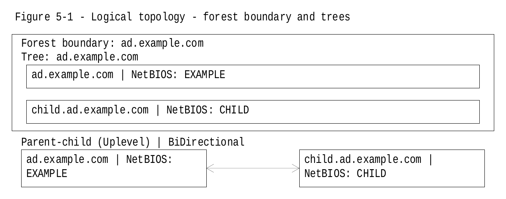
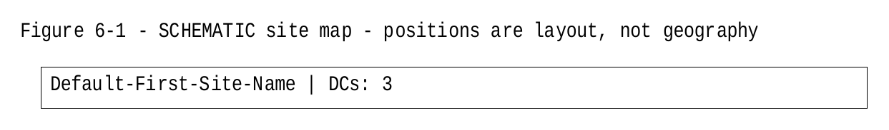
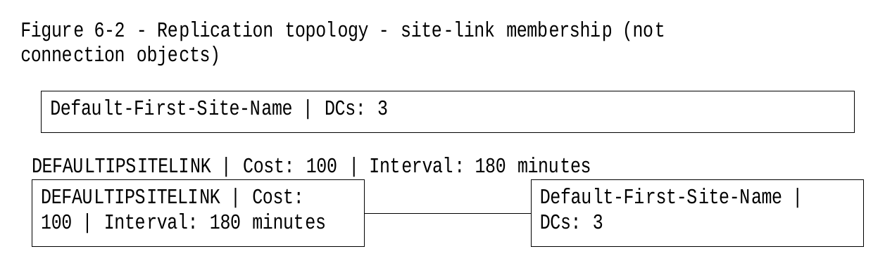
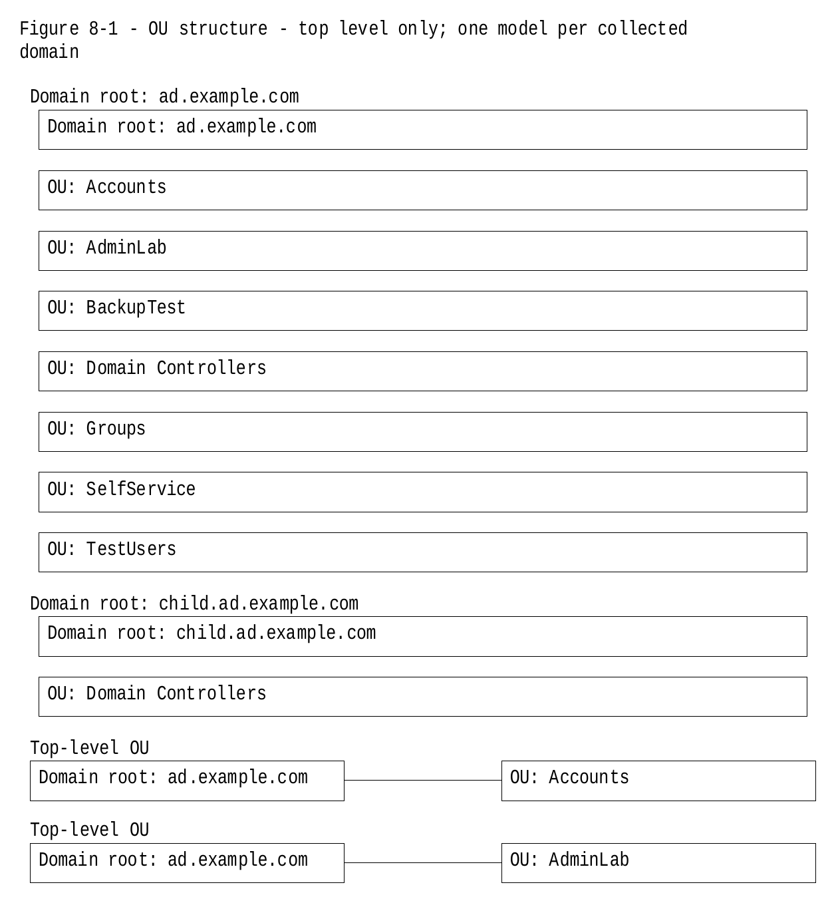

# AD Forest Overview

A controlled, evidence-first way to produce an Active Directory Forest Overview document:
a Windows PowerShell script collects forest data **read-only**, exports it as data files, and
fills a structured Word template by editing the DOCX package directly — no Microsoft Word
required to generate the document, and nothing in the forest is ever modified.

> **Status (2026-10-30):** Script **v1.5.2** with template **v1.1.1** is the current candidate.
> It is **workshop-approved for lab confirmation runs only — it is not cleared for production.**
> Lab confirmation is **complete** for the v1.5.x line: Part 1 (DEF-05 regression) and
> Part 3 (adopted fields) PASS against v1.5.1; Part 2 (diagrams) PASS on the v1.5.2
> retest, closing defect V151-01. Still outstanding: the Word rendering item (NOT RUN —
> no Word-equipped client yet) and Gates A–F of the production-clearance runbook
> (docs/PRODUCTION-CLEARANCE-RUNBOOK.md), for which the lab has issued a full-coverage
> fixture assembly plan (docs/FIXTURE-ASSEMBLY-PLAN.md).
> Treat every status claim in this repository at that scope.

## Contents

| Path | What it is |
|---|---|
| `script/Populate-ADForestOverview-v1.5.2.ps1` | The collector/exporter/filler (current version): v1.4.1 behaviour plus generated topology diagrams and the adopted coverage-gap completions. |
| `script/Populate-ADForestOverview-v1.4.1.ps1` | The previous candidate, retained for reference and regression comparison. |
| `templates/ad-forest-overview-template-v1.1.1.docx` | The supported template. Single shading per cell and a schema-valid `word/settings.xml`; passes full OOXML XSD validation (18/18 parts). |
| `templates/legacy/ad-forest-overview-template.docx` | The **original template — defective, kept only as the DEF-05 regression fixture** (Run A of the confirmation record). It carries 48 cells with duplicate `w:shd` shading and a `<w:zoom>` element missing its required attribute. **Do not use it to produce real documents.** |
| `docs/VERIFICATION-DEF05-CONFIRMATION.md` | The lab gate for DEF-05: two runs (defective-input regression + supported configuration) with exact expectations. |
| `docs/PRODUCTION-CLEARANCE-RUNBOOK.md` | Gates A–F that, together with the DEF-05 confirmation, govern production clearance. |
| `docs/VERIFICATION.md` | The original 12-item lab verification record (round 1, script v1.2). |
| `docs/VERIFICATION-v1.3.md` | The round-2 lab verification record (script v1.3), including the defect re-gate for DEF-01…DEF-04. |
| `docs/LAB-RUN-CHECKLIST-v1.2.md` | The original 12-point lab checklist issued with v1.2. |
| `docs/DEF-05-DISPOSITION.md` | The engineering disposition for DEF-05: origin, severity (P1), the shading ruling, and the required fix shape. |
| `docs/COMPARISON.md` | Three-way feature comparison used to scope v1.5 (2026-10-29). |
| `docs/ADOPTION-SPEC.md` | The field-level coverage-gap adoption spec: 286 fields classified; 8 ADOPT items implemented in v1.5; 35 ADOPT-OPTIONAL items deliberately not implemented. |
| `docs/V15-RECHECK-MEMO.md` | Independent re-check of v1.5: APPROVE WITH RESIDUAL FIXES (R1–R3), lab scope. |
| `docs/V151-FOCUSED-RECHECK-MEMO.md` | Focused re-check of v1.5.1: APPROVE — R1/R2/R3 verified closed. |
| `docs/LAB-v1.5.1-RESULTS.json` | The lab's v1.5.1 confirmation results: Part 1 PASS, Part 3 PASS, Part 2 FAIL on V151-01. |
| `docs/V151-01-DEFECT-REPORT.md` | The lab's defect report for V151-01 (Figure 6-2, single-site topology). |
| `docs/DEFECT-V151-01-DISPOSITION.md` | Disposition for V151-01, including the operator's RC-01 waiver addendum. |
| `docs/V152-FOCUSED-RECHECK-MEMO.md` | Focused re-check of v1.5.2: APPROVE WITH RESIDUAL FIXES (RC-01, waived). |
| `docs/VERIFICATION-v1.5.2-LAB-RETEST.md` | The lab retest record for v1.5.2: Part 2 items only. |
| `docs/VERIFICATION-v1.5.1-LAB.md` | The lab confirmation record for v1.5.1: DEF-05 regression, diagram checks, adopted-field checks. |
| `CHECKSUMS.sha256` | SHA-256 of the script and both templates. Verify before use. |

## What the script does

1. **Collect** — reads the forest with the ActiveDirectory module, **per domain** (every
   domain in `Get-ADForest`): domain controllers, trusts, object counts, password and
   Kerberos policy, fine-grained password policies, gMSAs, top-level OUs, GPOs and protected
   groups. Forest-level reads cover sites, subnets, site links, optional features, KDS root
   keys and schema data; DNS zones and forwarders are read where the DnsServer module can
   reach a DC. A domain or section that cannot be read is reported as a gap — never
   silently presented as empty or absent.
2. **Export** — writes the collection to an evidence folder: `AD-Forest-Data.json`, one CSV
   per template table, `Warnings.csv`, `SectionStatus.csv`, and (v1.4+) a
   `DOCX-Normalization.json` disclosure record.
3. **Populate** — copies the template to a temporary file, fills it by editing
   `word/document.xml` in place (tables matched by header text, key/value tables by row
   label; Section 4 cloned per additional domain), and only then moves the finished document
   to `-OutputPath`.

It deliberately leaves narrative content — business purpose, risks, dependencies,
tiering rules, backup tooling, Entra ID material — for a human to write.

## New in v1.5 / v1.5.1 — adopted features

v1.5 widened the document's coverage in two directions, and v1.5.1 hardened both:

- **Generated topology diagrams.** Four figures are rendered at fill time from the
  collected data and embedded in the document as vector (EMF) parts: Figure 5-1 (forest
  trusts, drawn from the same decoded trust data as the trusts table), Figure 6-1 (site
  topology — an honestly labelled schematic, since AD holds no reliable geography),
  Figure 6-2, and Figure 8-1. Replaying the same collection reproduces byte-identical
  diagram parts.
- **Completed Optional Features register.** Optional features are now reported
  generically — name, state, and enabled-scope DNs — rather than only the well-known
  features being recognised.
- **Five additional fine-grained password-policy settings** in the existing FGPP
  comparison table, completing the security-settings picture per policy.
- **Successful-empty diagnostics.** A collection section that ran successfully and
  found nothing now states that explicitly, so an empty result is never mistaken for
  a collection gap.
- **Hardening (v1.5.1).** Diagram parts are committed to the package fail-closed: a
  package-commit fault refuses publication at exit 1 rather than leaving a partial
  document, and malformed replay data can no longer produce non-parseable XML.

These additions came out of a field-by-field coverage review against established AD
documentation practice: 286 candidate fields were classified, 8 were adopted, and 35
further items were assessed and deliberately left optional (see
`docs/ADOPTION-SPEC.md`). Each adopted item was specified on its own merits and
implemented natively in this script's collector and filler — the coverage lessons were
adopted and learned; no code was taken from any other tool.

## Example diagrams

Real output of v1.5.2 replaying a synthetic example dataset (not mockups — the
EMF originals and provenance are in [docs/DIAGRAMS.md](docs/DIAGRAMS.md)):

**Figure 5-1 — Logical topology**


**Figure 6-1 — Site map (schematic)**


**Figure 6-2 — Replication topology**


**Figure 8-1 — OU structure (panel 1 of 2)**


## Requirements

- Windows PowerShell **5.1** (the target runtime; the script is kept 5.1-compatible).
- RSAT **ActiveDirectory** module; **DnsServer** and **GroupPolicy** modules where available
  (missing modules degrade to disclosed gaps, not failures of the run).
- Read access to the forest. For ACL-protected objects, an identity without sufficient
  rights gets an honest "none visible to this identity" result, not a false empty.

## Permissions required

The script only ever reads. It runs as the identity that invokes it; where `-Credential`
is supplied, that credential is used for the ActiveDirectory cmdlets (the GroupPolicy
and DnsServer cmdlets do not accept `-Credential` and always run as the invoking user —
the script discloses this in its run notes). What each part needs:

- **Core directory data — most of the document.** Forest, domains, trusts, domain
  controllers, sites, site links, subnets, OUs, password policies (default and
  fine-grained), optional features, and schema/configuration reads are all readable by
  any **authenticated domain user** under default AD permissions. No administrative
  rights are required for these sections.
- **Group Policy.** `Get-GPO -All` per domain plus an XML report of the Default Domain
  Policy are readable by authenticated users under default GPO/SYSVOL permissions. A
  GPO whose ACL hides it from the run identity is reported as a gap, not an empty list.
- **DNS server data — the exception.** Zones, forwarders and conditional forwarders are
  read with the DnsServer module directly against a writable forest-root DC. Those
  cmdlets use management interfaces that in practice require **administrative rights on
  that DC**; a standard user cannot open them. Without those rights the DNS sections
  are recorded as disclosed gaps and the run continues — this is the one area where a
  least-privilege run loses content.
- **gMSA and KDS root key.** Read as directory objects (inventory properties only; no
  password material is ever read). Where no gMSA or KDS root key exists, the underlying
  calls error rather than returning empty, so those sections surface as failed — the
  evidence distinguishes that from a successful empty result.
- **ACL-protected objects.** Anything the identity cannot see (for example
  adminSDHolder-protected group membership) yields an explicit "none visible to this
  identity" result, never a silent empty. A Domain Admin identity maximises visibility;
  it is not required.
- **Replay mode (`-DataFile`).** No directory permissions at all — the run reads only
  the previously exported data files.
- **Local machine.** No local administrator rights: the RSAT modules, read access to
  the template file, and write access to the output folder are sufficient.

*Provenance:* all lab validation to date ran as a Domain Admin. The standard-user
behaviour above is derived from the script's collection code and the cmdlets'
requirements, and is consistent with its gap reporting; it has not yet been exercised
end-to-end in the lab under a least-privilege identity.

## Usage

Live run (collect + export + fill):

```powershell
.\script\Populate-ADForestOverview-v1.5.2.ps1 `
  -TemplatePath .\templates\ad-forest-overview-template-v1.1.1.docx `
  -OutputPath   .\AD-Forest-Overview.docx
```

Replay a previous collection without touching AD (the lab's primary mode):

```powershell
.\script\Populate-ADForestOverview-v1.5.2.ps1 `
  -DataFile     .\AD-Forest-Overview-Data-20261029-101500\AD-Forest-Data.json `
  -TemplatePath .\templates\ad-forest-overview-template-v1.1.1.docx `
  -OutputPath   .\AD-Forest-Overview.docx
```

Export only (no document): add `-ExportOnly`. Useful options: `-OutputFolder` (evidence
folder; a non-empty one is refused unless `-Overwrite`), `-Server` / `-Credential` (pin a DC
/ alternate identity for the bound domain), `-SkipObjectCounts`, `-SkipGpoLinks`,
`-SkipDnsForwarders`.

## Exit-code contract

| Code | Meaning |
|---|---|
| 0 | Complete; no skipped data coverage. |
| 2 | Completed **with gaps** — warnings, partial collection, unverified sections, or intentional skips. Read `SectionStatus.csv` / the document's validation section; this is not an execution failure. |
| 1 | Failed or refused. On refusals no document is written and any previous output is left intact. |

## Safety posture

- **Read-only by construction:** every external AD/GPO/DNS call is a `Get-*` cmdlet
  (verified by AST inspection at each review round).
- **Refuses to destroy:** a non-empty evidence/output folder is refused in every mode
  (live, replay, export) unless `-Overwrite` is given, and an output path that aliases the
  template is refused — the template can never be overwritten by its own output.
- **Honest gaps:** anything not collected is labelled as such in the document and the
  evidence files, with the reason. Absence is only ever claimed when collection succeeded.
- **Template-defect normalization (DEF-05):** when a template carries cells with duplicate
  shading elements, the script repairs them in the output (last value wins, schema order
  restored) and **discloses the count** in the console summary and in
  `DOCX-Normalization.json`. Normalization alone does not change the exit code.

## Verification history (summary)

- **v1.2** passed workshop review; **failed** the first real lab run with four defects
  (DEF-01…DEF-04: folder-guard bypass in replay mode, a template label mismatch, a
  trust-kind mislabel, unnumbered cloned headings).
- **v1.3** fixed DEF-01…DEF-04; workshop re-check approved; lab round 2 verified all four
  fixed on real Windows/AD. Overall lab verdict remained **INCOMPLETE** for lab-environment
  reasons only (fixture, cross-DC connectivity, no Word client) — see the runbook.
- **v1.4 / v1.4.1 + template v1.1 / v1.1.1** closed DEF-05 (duplicate `w:shd` making every
  generated DOCX OOXML-schema-invalid, plus a missing `w:zoom` percent attribute), including
  publication-aware failure reporting for the normalization-evidence write. Each step was
  verified by an independent re-check seat before the next began.
- **v1.5** added generated diagrams (Figures 5-1, 6-1, 6-2, 8-1, rendered at fill time from
  the collected data as embedded vector EMF parts — Figure 6-1 is an honestly labelled
  schematic, since AD holds no reliable geography) and the 8 ADOPT completions from the
  coverage-gap adoption spec (full Optional Features register incl. enabled-scope DNs; five
  fine-grained password-policy settings in the existing comparison table; successful-empty
  collection diagnostics). Independent re-check: APPROVE WITH RESIDUAL FIXES (R1 analyzer
  parity, R2 an inherited malformed-replay XML defect, R3 diagram package-commit hardening).
- **v1.5.1** closed R1–R3 (analyzer totals back to the v1.4.1 baseline with zero additions;
  `xml:space` serialization corrected; package-commit faults now refuse publication at
  exit 1). Focused independent re-check: **APPROVE** for supervised lab confirmation. One
  informational note: a script help line understates the v1.5.1 change scope (metadata only).
- **v1.5.2** fixes lab defect **V151-01** (Figure 6-2 rejected a valid single-site
  topology: a fully resolved one-member site link was treated as unverified). One
  functional line changed; everything else frozen. The lab's v1.5.1 confirmation had
  already returned Part 1 and Part 3 PASS, with Figures 5-1/6-1/8-1 passing on real
  data. Focused re-check of the fix (against the lab's own exported data): APPROVE WITH
  RESIDUAL FIXES — the sole residual, RC-01, was a brief-wording conflict over the
  template's human Design placeholder in the 6-2 caption; the operator **waived RC-01**
  (the placeholder is the template working as designed). The lab Part 2 retest is the
  remaining confirmation step.
- **Not yet verified anywhere:** production clearance. That requires the v1.5.2 lab
  Part 2 retest and Gates A–F (healthy cross-DC collection, full fixture, authoritative
  trust/Kerberos comparisons, Microsoft Word validation, final audited bundle).

## File integrity

Verify downloads against `CHECKSUMS.sha256`. Current MD5s, for cross-checking against the
lab records:

- Script v1.5.2 — `63ceb38e49e4c900f8d8cb045f0af20b` (lab-confirmed)
- Script v1.5.1 (superseded) — `af74c882be90cb53e071dabb45bc2026`
- Script v1.4.1 (superseded) — `cac3b3102e2f9289aa1add2ffac57683`
- Template v1.1.1 — `a3e0fdb3fe23de25a701dcda265b0383`
- Legacy template (defective fixture) — `0f05c69495ed4a646db5c27527c338ce`
